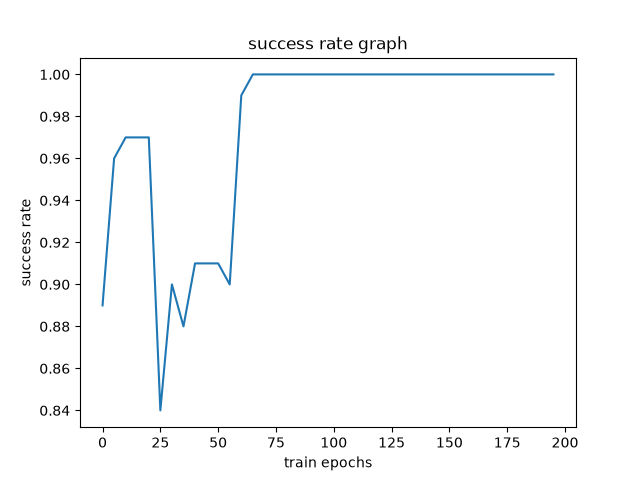
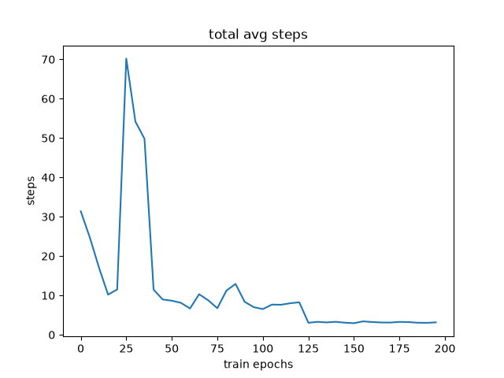
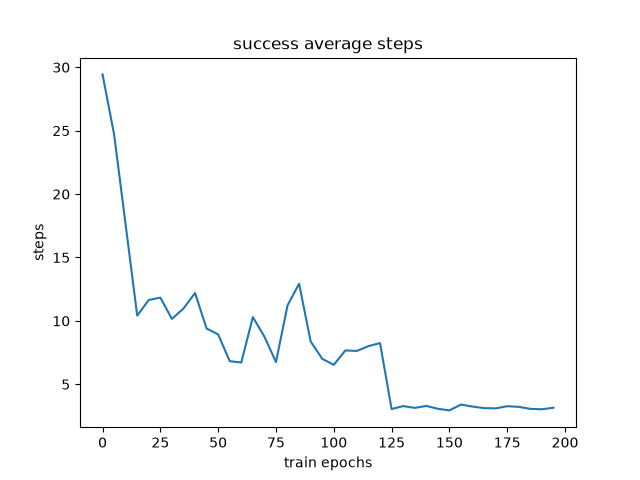
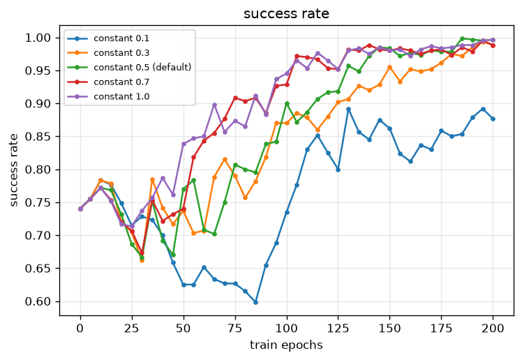

# Reinforcement Demo

To install requirements, run

```sh
cd 8-Reinforcement/

pip install -r ./requirements.txt
```

That's interesting process for reinforce training.

See output/ dir

This is a graph about success rate.

It increased in beginning and dropped.

After ups and downs several times

It reach 100%


This is a graph about average steps to reach `the end`, the end can be wolf (failure) or apple (success).

It means how long will it cost to get a feedback, whatever it is.

And it increase in process.



This is the average success steps which means how many steps enable you to reach the positive feedback. So when it increase, just keep going


---

## Alpha: Willing to Learn

The alpha on train process presents the willing to explore.

If alpha is near 1. It will make the agent consider the future is more important.

If alpha is near 0. The agent will not consider future, just walk as current state.

```python
Q[x, y, ai] = (1 - alpha) * Q[x, y, ai] + alpha * target
```

We can see interesting result via pictures



Low alpha makes agent learn slower.

If you are interesting about other graph, see more on [./output/alpha/]
